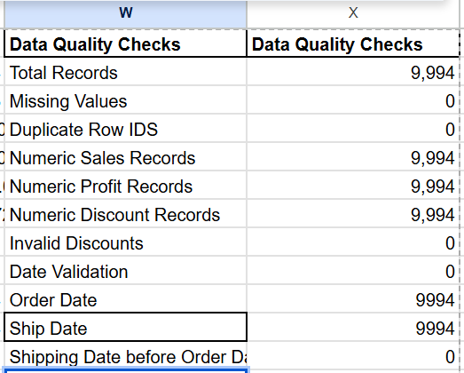
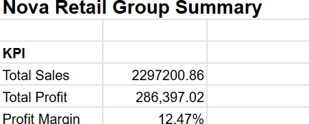
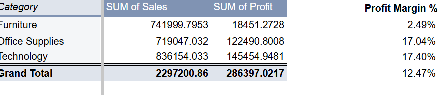

# Data Cleaning and Validation – Google Sheets

## Overview

Before investigating Nova Retail Group's sales performance and profitability, I conducted a data quality assessment using Google Sheets.

The dataset contained 9,994 retail sales records across 21 columns. My objective was to assess data completeness, identify potential duplicates, validate financial information and check the consistency of order and shipping dates.

I used built-in Google Sheets functions to perform these checks and documented the results in a Data Quality Assessment Summary.

## 1. Dataset Size and Completeness

I began by calculating the total number of records using the `COUNTA()` function.

**Formula:**

`=COUNTA(A2:A)`

**Result: 9,994 records**

This established the number of records available for analysis, excluding the column headings.

I then checked for missing values across the dataset using `COUNTBLANK()`.

**Formula:**

`=COUNTBLANK(A2:U9995)`

**Result: 0 missing values**

This confirmed that there were no blank cells within the selected data range.

## 2. Duplicate Record Identification

To investigate potential duplicate identifiers, I compared the total number of Row IDs with the number of unique Row IDs.

**Formula:**

`=COUNTA(A2:A9995)-COUNTUNIQUE(A2:A9995)`

**Result: 0 duplicate Row IDs**

This confirmed that every Row ID was unique. No records required removal due to duplicate Row IDs.

This check assessed identifier uniqueness rather than whether multiple legitimate transactions shared the same Order ID.

## 3. Financial Data Validation

Accurate financial information is essential for evaluating sales performance and profitability.

I used the `COUNT()` function to establish whether Google Sheets recognised the Sales, Profit and Discount fields as numeric values.

**Sales validation:**

`=COUNT(R2:R9995)`

**Profit validation:**

`=COUNT(U2:U9995)`

**Discount validation:**

`=COUNT(T2:T9995)`

Each calculation returned **9,994**, confirming that all records contained numeric values in these three fields.

I retained negative profit values because they may represent genuine loss-making transactions rather than data errors.

## 4. Discount Range Validation

Discounting is an important part of this investigation because management wants to understand its relationship with profitability.

I checked whether any discounts were below 0% or above 100%.

**Formula:**

`=COUNTIF(T2:T9995,"<0")+COUNTIF(T2:T9995,">1")`

**Result: 0 invalid discounts**

All discount values fell within the expected range of 0 to 1, where 0 represents no discount and 1 represents a 100% discount.

This confirmed that the discount field was suitable for further analysis.

## 5. Order and Shipping Date Validation

To support time-based sales analysis, I checked whether the Order Date and Ship Date fields were recognised as numeric date values in Google Sheets.

**Order Date:**

`=COUNT(C2:C9995)`

**Ship Date:**

`=COUNT(D2:D9995)`

Both calculations returned **9,994**, indicating that all entries in the two columns were stored as numeric values.

I then investigated whether any orders had shipping dates earlier than their order dates.

**Formula:**

`=SUMPRODUCT(--(D2:D9995<C2:C9995))`

**Result: 0 invalid shipping sequences**

This confirmed that no recorded shipping date preceded its corresponding order date.

## 6. Data Quality Assessment Results

## 7. Data Preparation Outcome

The initial assessment found no missing values, duplicate Row IDs, invalid discount ranges or shipping dates occurring before their corresponding order dates.

All Sales, Profit and Discount entries were recognised as numeric values.

Based on these checks, no records required deletion or correction.

The dataset was therefore considered suitable for initial exploratory analysis, while additional business-specific checks could be performed if unusual values emerged.

## Business Relevance

Completing this assessment before analysing sales and profitability helped establish confidence in the dataset.

Validating the financial fields reduced the risk of errors in revenue, profit and margin calculations, while checking dates supported more reliable time-based analysis.

The next stage focuses on evaluating Nova Retail Group's financial performance, identifying profitability patterns and investigating opportunities for business improvement.

## Exploratory Data Analysis – Sales and Profitability

### 1. Business Objective

Following data validation, I analysed Nova Retail Group's sales and profitability to evaluate overall financial performance and identify underperforming product categories.

### 2. Key Performance Indicators (KPIs)

I created a KPI Summary in Google Sheets using the following calculations:

| KPI | Google Sheets Formula | Result |
|---|---|---:|
| Total Sales | `=SUM('Data Cleaning'!R2:R9995)` | 2,297,200.86 |
| Total Profit | `=SUM('Data Cleaning'!U2:U9995)` | 286,397.02 |
| Profit Margin | `=B5/B4` | 12.47% |

The analysis showed that Nova Retail Group generated approximately 2.3 million in sales and 286,397 in profit, representing an overall profit margin of 12.47%.

### 3. Sales and Profit Analysis by Category

I created a Pivot Table using the following configuration:

- Rows: CategoryKPI
- Values: Sales, summarised by SUM
- Values: Profit, summarised by SUM

I then calculated the profit margin for each category by dividing total category profit by total category sales.

**Formula:** `=C2/B2`

| Category | Total Sales | Total Profit | Profit Margin |
|---|---:|---:|---:|
| Furniture | 741,999.80 | 18,451.27 | 2.49% |
| Office Supplies | 719,047.03 | 122,490.80 | 17.04% |
| Technology | 836,154.03 | 145,454.95 | 17.40% |
| **Grand Total** | **2,297,200.86** | **286,397.02** | **12.47%** |

.png>)

### 4. Key Business Findings

**Technology leads in both sales and profitability.** It generated approximately 836,154 in sales and 145,455 in profit.

**Office Supplies demonstrates strong profitability.** Despite generating the lowest sales among the three categories, it achieved a 17.04% profit margin.

**Furniture is the main area of concern.** Although it generated approximately 742,000 in sales, it produced only 18,451 in profit, resulting in a margin of 2.49%.

This suggests that strong revenue performance does not necessarily translate into strong profitability.

### 5. Business Recommendations and Further Investigation

Based on the initial findings, I recommend investigating Furniture's low profitability before making pricing or operational changes.

The next stage will use SQL to examine:

- Loss-making products and sub-categories
- The relationship between discounting and profitability
- Regional profitability differences
- Customer segment performance
- Sales and profit trends over time

These investigations will help identify potential drivers of low margins and support more targeted recommendations.

### 6. Tools and Techniques Demonstrated

Google Sheets was used for data validation, financial calculations, Pivot Tables, percentage formatting and exploratory business analysis.

