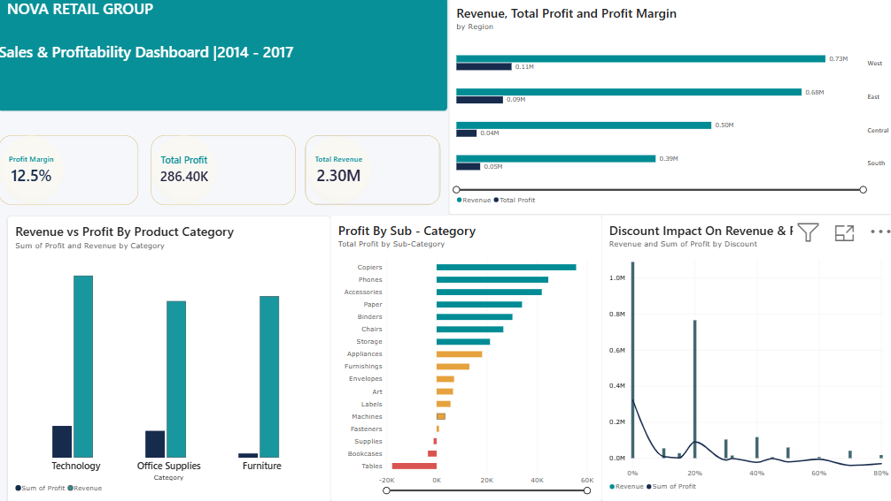
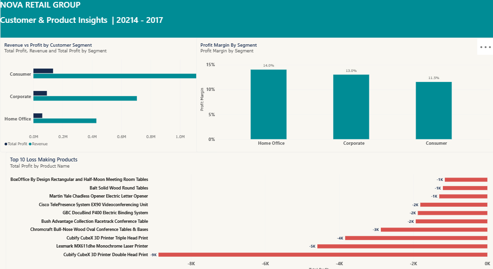

## Power BI — Sales & Profitability Dashboard

### Overview

Following data cleaning and validation in Google Sheets and exploratory business analysis using SQL, Power BI was used to transform the findings into an interactive dashboard.

The dashboard analyses 9,994 retail transaction records from 2014 to 2017, with a focus on understanding the factors affecting Nova Retail Group's profitability.

DAX measures were created to calculate total revenue, total profit and profit margin dynamically, allowing users to explore financial performance across different product categories, regions and customer segments.

### Dashboard 1: Sales & Profitability Overview

This dashboard provides an overview of the company's financial performance and identifies areas contributing to profitability challenges.

**Key visualisations:**

- **Financial KPIs:** Total revenue, total profit and profit margin.
- **Revenue vs Profit by Category:** Compares sales and profitability across Technology, Furniture and Office Supplies.
- **Profit by Sub-Category:** Highlights profitable and loss-making product groups.
- **Discount Impact on Revenue & Profit:** Examines the relationship between discount levels, sales revenue and profitability.
- **Regional Performance:** Compares revenue and profit across the West, East, South and Central regions.

**Business purpose:** Identify product categories, discounting patterns and regions requiring management attention.

### Dashboard 2: Customer & Product Insights

This dashboard focuses on customer segment profitability and individual products contributing to financial losses.

**Key visualisations:**

- **Revenue vs Profit by Customer Segment:** Compares financial contributions from Consumer, Corporate and Home Office customers.
- **Profit Margin by Customer Segment:** Identifies customer groups generating stronger margins relative to revenue.
- **Top 10 Loss-Making Products:** Highlights individual products responsible for the largest financial losses.

**Business purpose:** Support targeted decisions about product pricing, discount strategies and customer segment performance.

### Key Business Insights

1. Furniture generates substantial revenue but achieves a relatively low profit margin of 2.49%.
2. Tables, Bookcases and Supplies are loss-making sub-categories.
3. Heavy discounting is associated with significant financial losses, particularly across selected products.
4. Central records the lowest regional profit margin at 7.92%.
5. Consumer generates the highest revenue, while Home Office achieves the strongest segment profit margin at approximately 14.03%.

### Business Recommendations

- Review excessive discounting and introduce product-level profitability checks.
- Investigate pricing and costs for loss-making sub-categories.
- Examine the factors affecting Central's profitability.
- Monitor high-revenue customer segments to identify opportunities for margin improvement.
- Prioritise sustainable profit growth rather than revenue or transaction volume alone.

### Conclusion

The Power BI dashboard translates the SQL findings into accessible, interactive business reporting. It allows management to identify profitability challenges, compare performance across different business areas and explore opportunities for improving financial outcomes.

The project demonstrates practical skills in DAX, data visualisation, KPI reporting, dashboard design and business analysis. 