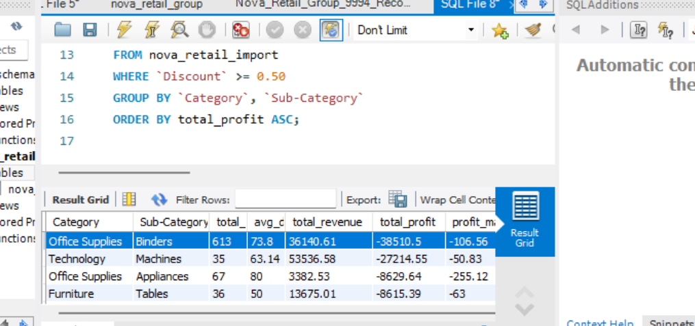
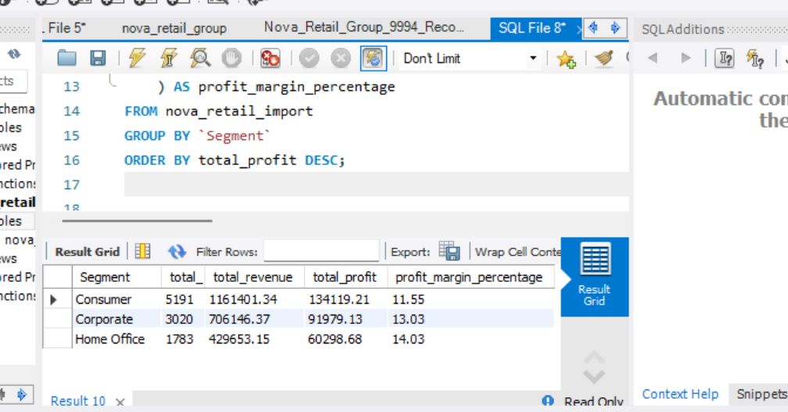

/*
NOVA RETAIL GROUP
SQL ANALYSIS – PROFITABILITY INVESTIGATION

OVERVIEW
Following data cleaning, validation, and initial
KPI analysis in Google Sheets, SQL is used to
investigate the factors influencing profitability
across 9,994 retail transactions.

BUSINESS PROBLEM
The initial analysis revealed total revenue of
2,297,200.86 and profit of 286,397.02, resulting
in a profit margin of 12.47%.

Despite substantial sales, the business needs
to understand which factors are limiting
overall profitability.

ROLE OF SQL
SQL will be used to analyse:
- Product category and sub-category performance
- Regional sales and profitability
- The impact of discounts on profit
- Customer segment performance
- Loss-making products

EXPECTED OUTCOME
Identify key drivers of profitability and
provide actionable recommendations to improve
business performance.
*/

SQL Business Question 1: Product Category Performance
Business question: Which product categories generate the highest sales and profit, and are high-revenue categories necessarily the most profitable?

-- ==================================================
-- BUSINESS QUESTION 1: CATEGORY PERFORMANCE
-- ==================================================

-- Objective:
-- Compare revenue, profit, and profit margins
-- across product categories to identify
-- strong performers and profitability concerns.

USE nova_retail_group;

SELECT
    `Category`,
    ROUND(SUM(`Sales`), 2) AS total_revenue,
    ROUND(SUM(`Profit`), 2) AS total_profit,
    ROUND(
        SUM(`Profit`) / NULLIF(SUM(`Sales`), 0) * 100,
        2
    ) AS profit_margin_percentage
FROM nova_retail_import
GROUP BY `Category`
ORDER BY total_revenue DESC;

/*
BUSINESS INSIGHT 1: CATEGORY PERFORMANCE

Technology is the strongest-performing category,
generating 836,154.03 in revenue and 145,454.95
in profit, with a 17.40% profit margin.

Furniture presents the greatest profitability
concern. Despite generating 741,999.80 in
revenue, it contributes only 18,451.27 in
profit, resulting in a 2.49% margin.

Office Supplies generates 122,490.80 in profit
from 719,047.03 in revenue, achieving a
17.04% profit margin.

BUSINESS IMPLICATION

High sales revenue does not necessarily
translate into strong profitability.

Furniture requires further investigation
to identify potential loss-making products
and discounting practices affecting margins.

NEXT STEP

Investigate profitability at the
sub-category level to identify the
specific drivers of Furniture's low margin.
*/

-- BUSINESS QUESTION 2:
-- Which sub-categories generate the highest
-- and lowest profits?

SELECT
    `Category`,
    `Sub-Category`,
    ROUND(SUM(`Sales`), 2) AS total_revenue,
    ROUND(SUM(`Profit`), 2) AS total_profit,
    ROUND(
        SUM(`Profit`) / NULLIF(SUM(`Sales`), 0) * 100,
        2
    ) AS profit_margin_percentage
FROM nova_retail_import
GROUP BY `Category`, `Sub-Category`
ORDER BY total_profit ASC;

                                  

### Business Insight 2: Sub-Category Profitability

**Key Findings**

The SQL analysis identified three loss-making sub-categories: Tables, Bookcases and Supplies.

Tables recorded the largest loss of 17,725.48 despite generating 206,965.53 in revenue. Bookcases also reported a loss of 3,472.56, helping explain Furniture's low overall profit margin of 2.49%.

Supplies generated a further loss of 1,189.10, indicating that profitability challenges extend beyond Furniture.

Machines generated substantial revenue of 189,238.63 but achieved only a 1.79% profit margin, suggesting another area requiring investigation.

**Business Implications**

These findings demonstrate that high sales revenue does not guarantee profitability. Loss-making sub-categories may be reducing the financial benefits generated by stronger-performing products.

**Recommendations**

- Investigate discount levels and pricing strategies for Tables and Bookcases.
- Review product-level profitability within the three loss-making sub-categories.
- Examine whether high discounts are associated with low margins for Machines.
- Prioritise profitable growth rather than sales volume alone.

**Next Analytical Step**

Investigate the relationship between discounting and profitability to determine whether discount practices contribute to the identified losses.

### BUSINESS QUESTION 3: DISCOUNT ANALYSIS
-- Objective: Examine how discount levels
-- relate to revenue, profit, and profit margins.

SELECT
    ROUND(`Discount` * 100, 0) AS discount_percentage,
    COUNT(*) AS total_transactions,
    ROUND(SUM(`Sales`), 2) AS total_revenue,
    ROUND(SUM(`Profit`), 2) AS total_profit,
    ROUND(
        SUM(`Profit`) / NULLIF(SUM(`Sales`), 0) * 100,
        2
    ) AS profit_margin_percentage
FROM nova_retail_import
GROUP BY ROUND(`Discount` * 100, 0)
ORDER BY discount_percentage ASC;

                                  

/*
B
/*
BUSINESS INSIGHT 3: DISCOUNT ANALYSIS

The analysis identified a strong association
between high discount levels and financial losses.

Transactions without discounts achieved a
29.51% profit margin.

However, transactions with discounts between
50% and 80% generated negative profits.

The 70% discount group recorded a total loss
of 40,075.36, while the 80% discount group
recorded a loss of 30,539.04.

BUSINESS RECOMMENDATIONS

1. Review discounting practices above 40%.

2. Investigate products frequently sold
   at discounts of 50% or more.

3. Introduce profitability checks before
   approving substantial discounts.

4. Evaluate whether lower discount levels
   could protect profit margins.

NEXT STEP

Investigate which product categories and
sub-categories receive heavy discounts
and contribute to financial losses.
*/

SQL Business Question 4: 

Heavy Discounting by Sub-Category
Business question: Which product sub-categories generate financial losses when discounts are 50% or higher?

SELECT
    `Category`,
    `Sub-Category`,
    COUNT(*) AS total_transactions,
    ROUND(AVG(`Discount`) * 100, 2) AS avg_discount_percentage,
    ROUND(SUM(`Sales`), 2) AS total_revenue,
    ROUND(SUM(`Profit`), 2) AS total_profit,
    ROUND(
        SUM(`Profit`) / NULLIF(SUM(`Sales`), 0) * 100,
        2
    ) AS profit_margin_percentage
FROM nova_retail_import
WHERE `Discount` >= 0.50
GROUP BY `Category`, `Sub-Category`
ORDER BY total_profit ASC;

                                   

/*
BUSINESS INSIGHT 4: HEAVY DISCOUNTING

The SQL analysis revealed that aggressive
discounting is associated with substantial
financial losses despite generating sales.

Binders recorded 613 heavily discounted
transactions, resulting in a loss of 38,510.50.
Machines generated losses of 27,214.55,
while Appliances recorded a negative profit
margin of 255.12%.

In contrast, transactions without discounts
achieved a 29.51% profit margin.

These findings suggest that although discounts
may encourage purchases, higher transaction
volumes do not necessarily generate higher
profits. However, the analysis does not
establish that discounts increased demand.

 ###  RECOMMENDATION

Nova Retail Group should prioritise profitable
sales growth over transaction volume by
reviewing excessive discounts, introducing
minimum profit margin thresholds, and
monitoring loss-making products.

The goal is to increase sustainable
profitability rather than sales alone.

Business Question 5: Regional Sales and Profitability
Business question: Which regions generate the highest revenue and profit, and which regions are underperforming?

### BUSINESS INSIGHT 5: REGIONAL PERFORMANCE

The West region demonstrated the strongest
financial performance, generating 725,457.82
in revenue and 108,418.45 in profit, with
a 14.94% profit margin.

The East region also performed strongly,
achieving a 13.48% profit margin.

However, the Central region recorded the
lowest profit margin at 7.92%, despite
generating 501,239.89 in revenue.

Interestingly, Central generated more revenue
than South but contributed less profit.

This reinforces the finding that higher
sales revenue does not necessarily
translate into higher profitability.

BUSINESS RECOMMENDATION

Nova Retail Group should investigate
product profitability and discounting
practices in the Central region.

Management should also examine successful
pricing and product strategies in the West
and East regions to identify practices
that could improve profitability elsewhere.

### Business Question 6 — Customer Segment Profitability
Business question: Which customer segments generate the highest revenue and profit?

### BUSINESS INSIGHT 6: CUSTOMER SEGMENT PERFORMANCE

The Consumer segment generated the highest
revenue of 1,161,401.34 and total profit
of 134,119.21 across 5,191 transactions.

However, Consumer recorded the lowest
profit margin at 11.55%.

Home Office achieved the highest profit
margin of 14.03%, despite generating
the lowest total revenue.

Corporate also outperformed Consumer
on profitability, with a 13.03% margin.

### BUSINESS IMPLICATION

Higher sales volume and revenue do not
necessarily translate into stronger
profit margins.

### BUSINESS RECOMMENDATION

Nova Retail Group should investigate
discounting and product profitability
within the Consumer segment.

Management should also examine the
product mix and purchasing patterns
of Home Office customers to identify
opportunities for more profitable growth.

### Business Question 7 — Loss-Making Products
Business question: Which individual products generate the greatest financial losses?

This will help us move beyond broad categories and identify specific products that management should investigate.

/*
BUSINESS INSIGHT 7: LOSS-MAKING PRODUCTS

Product-level analysis identified significant
financial losses across Machines, Tables,
and Binders.

The Cubify CubeX Double Head 3D Printer
recorded the largest loss of 8,879.97,
with an average discount of 53.33%.

Other underperforming products included
3D printers, conferencing equipment,
meeting room tables, and binding systems.

Several of these products received substantial
discounts, reinforcing the earlier finding
that high sales revenue does not necessarily
translate into profitability.

### BUSINESS RECOMMENDATION

Nova Retail Group should review pricing,
product costs, and discounting practices
for its highest-loss products.

Management should introduce product-level
profitability monitoring and minimum-margin
checks before approving substantial discounts.

Further investigation is required to determine
the causes of these losses.

### Business Question 8 — Sales and Profit Trends
This is our final SQL business question.

How have revenue, profit and profit margins changed over time?

Before writing the query, we need to check how MySQL stored your order dates, because we initially imported them as text.

-- BUSINESS QUESTION 8:
-- Annual Sales and Profitability Trends

SELECT
    YEAR(STR_TO_DATE(`Order Date`, '%m/%d/%Y'))
        AS order_year,
    COUNT(*) AS total_transactions,
    ROUND(SUM(`Sales`), 2) AS total_revenue,
    ROUND(SUM(`Profit`), 2) AS total_profit,
    ROUND(
        SUM(`Profit`) / NULLIF(SUM(`Sales`), 0) * 100,
        2
    ) AS profit_margin_percentage
FROM nova_retail_import
GROUP BY order_year
ORDER BY order_year ASC;

### BUSINESS INSIGHT 8: ANNUAL SALES AND PROFIT TRENDS

Nova Retail Group demonstrated overall revenue
growth between 2014 and 2017, with revenue
reaching 733,215.26 in 2017.

Annual profit increased consistently from
49,543.97 in 2014 to 93,439.27 in 2017.

However, profitability did not improve at
the same rate as sales.

The profit margin peaked at 13.43% in 2016
before declining to 12.74% in 2017.

This indicates that although the business
expanded its sales activity, maintaining
profit margins remained a challenge.

### BUSINESS RECOMMENDATION

Nova Retail Group should investigate the
factors contributing to the decline in
profit margin during 2017.

Management should review discounting,
product mix, and regional performance
to identify opportunities for more
profitable growth.

The business should monitor both revenue
growth and profit margins rather than
focusing on sales performance alone.
