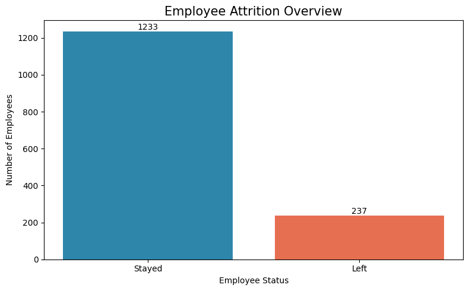
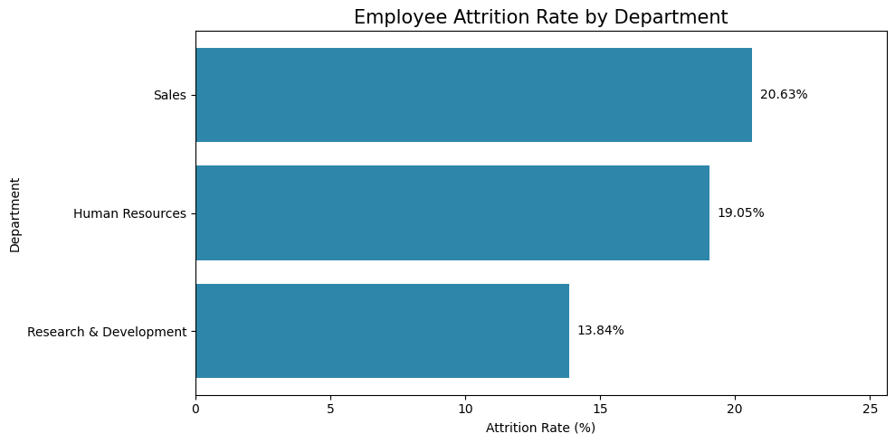
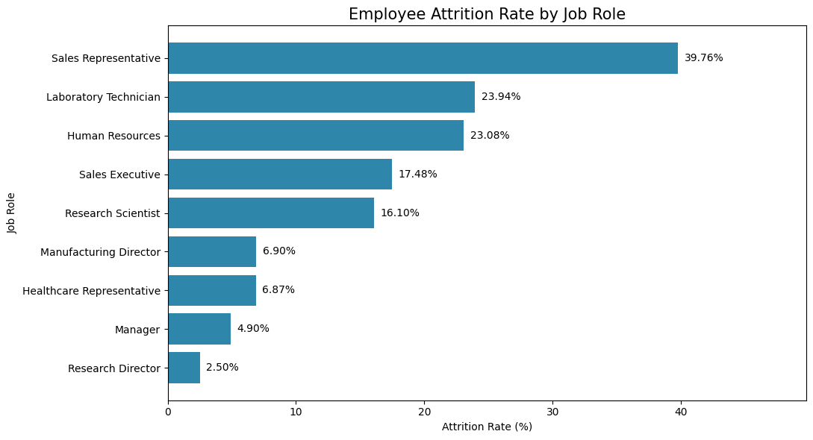

## Python analysis and validation

I used Python and pandas to check the cleaned employee dataset and validate the findings from my SQL analysis. The dataset contained 1,470 employee records: 237 employees had left and 1,233 had stayed, giving an overall attrition rate of 16.12%.

The chart below provides a visual representation of the Python analysis results using Matplotlib, making the findings easier to interpret.

 Furthermore, I  compared both departure counts and attrition rates across departments and job roles. Research & Development had the most departures (133), while Sales had the highest departmental attrition rate (20.63%). Laboratory Technicians had the most departures by job role (62), while Sales Representatives had the highest job-role attrition rate (39.76%, or 33 of 83 employees). Comparing rates as well as counts helped account for differences in group size.

The high attrition rate among Sales Representatives and the large number of Laboratory Technician departures give HR two clear priorities for follow-up. HR could review exit interviews, workload, pay and career progression in these roles to identify possible reasons for employees leaving before choosing targeted retention measures.

**Python evidence:** I used pandas to validate the 1,470-record dataset and calculate attrition counts and rates by department and job role. The output supports the findings discussed above.

### Department-Level Analysis
I compared employee attrition across departments to identify where the largest number of departures occurred. Research & Development recorded the highest number of employees leaving (133), followed by Sales (92) and Human Resources (12). However, employee counts alone do not account for differences in department size, so I also calculated attrition percentages.

### Comparing Attrition Rates
When department size was taken into account, the pattern changed. Although Research & Development had the greatest number of departures, Sales had the highest attrition rate at 20.63%, followed by Human Resources at 19.05%. Research & Development had the lowest departmental rate at 13.84%. This demonstrates why percentages provide better context than employee counts alone.

The chart below provides a visual representation of the Python analysis results using Matplotlib, making the findings easier to interpret.

### Job Role Analysis
I then drilled down from department level to individual job roles to identify where employee departures were concentrated. Laboratory Technicians recorded the highest number of departures (62), followed by Sales Executives (57) and Research Scientists (47).

### Job Role Attrition Rates
To avoid drawing conclusions from employee counts alone, I calculated the percentage of employees leaving within each job role. The analysis highlighted Sales Representatives as a major attrition hotspot, with 66.67% leaving. Laboratory Technicians also recorded a comparatively high rate of 22.22%, while some roles experienced substantially lower attrition.

The chart below provides a visual representation of the Python analysis results using Matplotlib, making the findings easier to interpret.

### Conclusion and Business Insights

The Python analysis identified key patterns in employee turnover across Vertex Healthcare Group's workforce.

Out of 1,470 employees, 237 left the organisation, representing an overall attrition rate of **16.12%**.

Although Research & Development recorded the highest number of departures (133), Sales had the highest departmental attrition rate at **20.63%**. This demonstrates why analysing percentages alongside employee counts is essential for identifying workforce risks.

Further investigation revealed that **Sales Representatives experienced the highest job-role attrition rate at 66.67%**, followed by Laboratory Technicians at 22.22%. These findings suggest that retention challenges are not evenly distributed across the organisation.

### Business Recommendations

- **Prioritise Sales retention:** Investigate workload, compensation, career progression and management support, particularly for Sales Representatives.
- **Investigate high-turnover roles:** Conduct employee feedback surveys and exit interview reviews to understand why employees leave.
- **Monitor attrition rates:** Track turnover by department and job role rather than relying solely on departure counts.
- **Develop targeted retention strategies:** Use the findings to guide employee engagement and retention initiatives.

### Business Impact

The analysis provides evidence to help management identify workforce areas requiring attention, prioritise retention resources and monitor employee turnover.

By combining Python analysis with SQL findings, the project demonstrates how data can support informed workforce decisions.

  