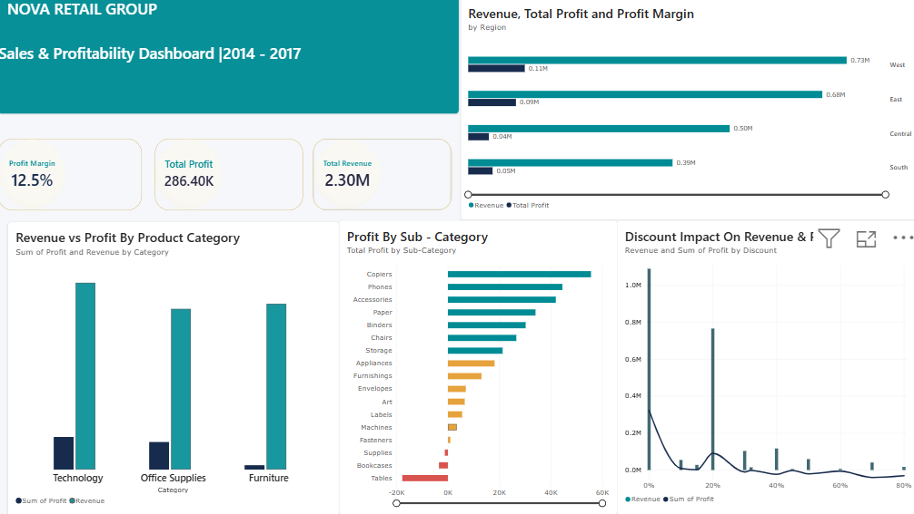
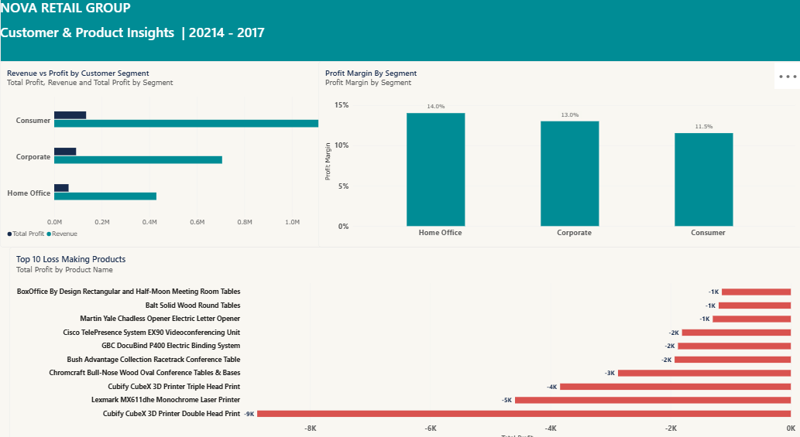

# Geridine Gaskin | Data Analytics Portfolio

### Beyond the Numbers: Exploring Data, Challenging Assumptions & Discovering Insights

**Data Analyst | SQL | Power BI | Excel | Python | Business Intelligence**

---

## Welcome to My Portfolio!

**What if the biggest number in a dataset isn't actually the most important one?**

A business can generate millions in revenue and still struggle to make a profit. A department can record the highest number of employee departures without having the highest attrition rate.

These are the kinds of questions that make data analytics fascinating to me.

I'm **Geridine Gaskin, a Data Analyst with hands-on experience in SQL, Power BI, Excel and Python**, passionate about transforming complex datasets into meaningful insights that support better business decisions.

My interest in analytics goes beyond creating dashboards, writing queries or generating reports. I enjoy understanding the problem behind the data, investigating patterns, identifying inconsistencies and challenging assumptions before drawing conclusions.

Through practical projects, independent research and continuous professional development, I've built experience in data cleaning, exploratory data analysis, data visualisation, business intelligence and analytical reporting.

I believe that **good analysis doesn't just explain what happened. It helps people understand why a pattern matters and what they should investigate or do next.**

This portfolio is a collection of my work, technical development and analytical journey. It demonstrates not only what I can do with data, but also how I approach problems, interpret findings and communicate recommendations.

---

## About Me

My professional and academic background has given me experience working with information, investigating organisational challenges and presenting evidence-based findings.

I hold a **Master's degree in Human Resource Management with Distinction from the University of Salford**, where I developed research, analytical and critical-thinking skills.

My postgraduate research involved examining NHS recruitment and equality data, identifying inconsistencies and limitations in available records, evaluating trends and communicating findings through structured analysis and spreadsheet visualization and recommendations for further improvement.

That experience reinforced an important lesson: **the quality of an analytical conclusion depends on the quality, completeness and interpretation of the underlying data.**

Alongside my academic background, I've invested in developing technical skills through structured training, certifications and independent projects.

My learning includes the IBM Data Analyst Professional Certificate, SQL and Python courses through DataCamp, and practical analytics training covering Excel, SQL and Power BI.

I'm continuing to develop my technical expertise, particularly in Python, while strengthening my existing skills through hands-on projects.

**My aim is to combine technical competence, business understanding and analytical curiosity to help organisations make more informed decisions.**

---

## My Technical Toolkit

The following proficiency levels reflect my current practical experience and self-assessment.

| Technology | Proficiency | Practical Experience |
|---|---|---|
| **Power BI** | Advanced | Interactive dashboards, DAX measures, KPI development, data visualisation and reporting |
| **SQL (MySQL)** | Intermediate | Data querying, filtering, aggregation, grouping, joins and exploratory analysis |
| **Microsoft Excel** | Intermediate | Data cleaning, validation, PivotTables, formulas and KPI calculations |
| **Google Sheets** | Intermediate | Data preparation, quality checks, exploratory analysis and reporting |
| **Python** | Beginner | pandas, data exploration, basic data manipulation and Matplotlib visualisations |
| **Git & GitHub** | Developing | Project organisation, version control and technical documentation |

### Core Analytical Competencies

- Data cleaning and preparation
- Data quality assessment and validation
- Exploratory data analysis (EDA)
- SQL querying and business analysis
- KPI development and performance reporting
- Business intelligence dashboard development
- Data visualisation and storytelling
- Identifying patterns, trends and anomalies
- Translating findings into actionable recommendations
- Communicating analytical limitations and assumptions

I believe technical proficiency develops through consistent practice. My goal is not simply to learn more tools, but to become more effective at selecting and applying the right techniques to solve real business problems.

---

## Featured Data Analytics Projects

Each project begins with a business problem and follows an analytical process from data preparation to findings and recommendations.

### Project 01 | Nova Retail Group — Sales & Profitability Analysis

**Business Question: How can a company generate strong sales revenue while experiencing profitability challenges?**

Imagine a retail company reporting millions in sales, yet some of its products consistently generate losses.

Is the problem weak demand, excessive discounting, poor product profitability or differences in regional performance?

This was the central challenge I investigated in my Nova Retail Group project.

**Dataset:** 9,994 historical retail transactions

**Tools:** Google Sheets, MySQL, Power BI and DAX

#### My Analytical Approach

I began by cleaning and validating the dataset in Google Sheets, checking for missing values and confirming the accuracy of financial calculations.

I then used MySQL to investigate sales and profitability across product categories, sub-categories, customer segments, regions and discount levels.

Finally, I developed a two-page interactive Power BI dashboard to communicate the findings through financial KPIs and business-focused visualisations.

#### Key Findings

**1. Strong revenue did not always translate into strong profitability.**

The business generated approximately **$2.30 million in revenue**, but only **$286,397 in profit**, representing a **12.47% profit margin**.

Furniture generated approximately $742,000 in sales but achieved a profit margin of only 2.49%.

This demonstrated why revenue alone can provide an incomplete picture of financial performance.

**2. Heavy discounting was associated with substantial losses.**

Transactions without discounts achieved a profit margin of approximately 29.51%, while several heavily discounted product groups experienced significant losses.

The analysis highlighted the importance of evaluating discounting strategies against profitability rather than sales volume alone.

**3. Regional performance revealed opportunities for improvement.**

The West achieved a profit margin of approximately 14.94%, compared with 7.92% in the Central region.

These differences suggested that regional profitability deserved closer investigation.

#### Business Recommendations

- Review discount policies for consistently unprofitable product groups.
- Investigate loss-making Furniture sub-categories.
- Monitor profit margins alongside revenue in management reporting.
- Examine regional differences to identify opportunities for improved profitability.
- Use interactive dashboards to support ongoing performance reviews.

**What This Project Demonstrates**

My ability to combine spreadsheet validation, SQL analysis and Power BI reporting to investigate a business problem and translate findings into practical recommendations.

**Project resources:** SQL scripts, dashboard screenshots, analytical findings and detailed project documentation are available in the Nova Retail Group project folder.

---

### Project 02 | Vertex Healthcare Group — Employee Attrition Analysis

**Business Question: Where should an organisation focus its employee retention efforts?**

Employee turnover can create recruitment costs, operational disruption and workforce planning challenges.

However, identifying the areas most affected by attrition requires more than simply counting the number of employees who leave.

This project investigated workforce attrition patterns across departments, job roles and employee characteristics.

**Dataset:** 1,470 employee records

**Tools:** MySQL, Python, pandas, Matplotlib and Excel

#### My Analytical Approach

I used SQL to explore employee attrition patterns, grouping records by department, job role and demographic characteristics.

I then extended the analysis using Python and pandas to validate the findings, calculate group-specific attrition rates and visualise important patterns using Matplotlib.

One of the most important aspects of this project was distinguishing between **employee departure counts and attrition rates**.

#### Key Findings

**1. The department with the most departures did not have the highest attrition rate.**

Research & Development recorded 133 employee departures, the largest number across the departments.

However, Sales recorded the highest departmental attrition rate at approximately 20.63%, compared with 13.84% in Research & Development.

This finding demonstrated why workforce size must be considered when comparing employee turnover.

**2. Certain job roles showed greater retention challenges.**

Laboratory Technicians recorded 62 departures, while Sales Executives recorded 57.

Further analysis of job-specific attrition rates helped distinguish roles with large numbers of departures from roles experiencing proportionally greater turnover.

**3. Workforce patterns require careful interpretation.**

The analysis explored differences across employee age groups, departments and roles.

Rather than assuming these patterns established the causes of attrition, I treated them as evidence for further investigation.

#### Business Recommendations

- Prioritise retention reviews in departments and roles with elevated attrition rates.
- Use exit interviews and employee feedback to investigate possible contributing factors.
- Review workload, career progression and employee development opportunities.
- Monitor both departure counts and attrition rates.
- Develop consistent workforce reporting to identify emerging retention risks.

**What This Project Demonstrates**

My ability to use SQL and Python together, validate analytical results, distinguish between different performance measures and communicate findings without overstating what the data proves.

**Project resources:** SQL analysis, Python visualisations, findings and detailed documentation are available in the Vertex Healthcare Group project folder.

---

## My Analytical Process

Every dataset tells a story, but understanding that story requires a structured approach.

### 01. Understand the Business Problem

Before analysing data, I identify the question the analysis needs to answer.

What decision will the findings support? Which metrics matter? What would make the results useful to the business?

### 02. Examine and Validate the Data

I assess the dataset for missing values, inconsistencies, duplicates, incorrect data types and other potential quality issues.

I also consider whether the available data is sufficiently complete to answer the business question.

### 03. Explore and Investigate

Using SQL, Excel or Python, I explore patterns, relationships, trends and unusual results.

I compare metrics carefully and consider whether alternative calculations or groupings could change the interpretation.

### 04. Visualise and Communicate

I use Power BI and Python visualisations to make complex findings easier to interpret.

My focus is on selecting visuals that communicate useful information rather than simply making dashboards visually appealing.

### 05. Recommend and Reflect

I translate analytical findings into practical recommendations while acknowledging uncertainty, data limitations and areas requiring further investigation.

**For me, the most valuable part of data analytics is connecting technical analysis with meaningful business decisions.**

---

## Currently Learning & Developing

Data analytics is a continuously evolving field, and professional development is an important part of my journey.

Although I've developed practical skills across several analytical tools, I'm committed to expanding my knowledge and improving the complexity of the problems I can solve.

### My Current Focus: Advancing My Python Skills

I'm building on my foundational Python knowledge to become more confident working with larger datasets and more advanced analytical techniques.

My learning priorities include:

- **Python and pandas:** More advanced data cleaning, transformation, aggregation and exploratory analysis.
- **NumPy:** Numerical operations and efficient data manipulation.
- **Matplotlib:** Creating clearer and more effective analytical visualisations.
- **Statistics:** Strengthening my understanding of distributions, correlations, statistical testing and interpretation.
- **SQL:** Developing greater proficiency with complex joins, common table expressions and window functions.
- **Power BI:** Deepening my understanding of DAX, data modelling, performance optimisation and dashboard design.

### How I'm Developing

I combine structured learning with practical application.

Rather than learning concepts in isolation, I aim to apply new techniques to datasets, compare different analytical approaches and document what I've learned.

As my skills develop, I will continue adding projects that demonstrate greater technical depth and increasingly complex business questions.

---

## Education & Professional Development

**MSc Human Resource Management — Distinction**  
University of Salford, United Kingdom

**BA Political Science & Linguistics — Second Class Upper**  
University of Ghana

### Relevant Analytics Training

- IBM Data Analyst Professional Certificate
- IBM Excel for Data Analytics
- DataCamp — Introduction to SQL
- DataCamp — Intermediate SQL
- DataCamp — Introduction to Python
- Victoria Solutions — Data Analytics Training (Excel, SQL and Power BI)

My academic background, professional experience and technical training have helped me develop a combination of research skills, business awareness and practical analytical capabilities.

---

## What Makes My Approach Different?

I don't believe completing an analysis simply means producing a chart or calculating a metric.

A useful analysis should also consider:

**Is the data reliable?**  
Poor-quality data can lead to misleading conclusions.

**Are we measuring the right thing?**  
A high number of employee departures doesn't automatically mean a department has the highest attrition rate.

**What is the business implication?**  
Strong revenue means little if profitability is consistently weak.

**What are the limitations?**  
Patterns and correlations should not automatically be interpreted as proof of causation.

**What should happen next?**  
Analytical findings become more valuable when they help guide further investigation or practical decisions.

These principles influence how I approach each project in this portfolio.

---

## Portfolio Development Roadmap

My portfolio will continue to evolve as I strengthen my technical skills and explore new business challenges.

**Completed and documented work**

- Nova Retail Group — Sales & Profitability Analysis
- Vertex Healthcare Group — Employee Attrition Analysis

**Ongoing development**

- Expanding Python-based exploratory data analysis
- Strengthening statistical analysis techniques
- Developing more advanced SQL queries
- Improving Power BI data modelling and DAX
- Building additional projects across different business domains
- Refining technical documentation and analytical storytelling

I see this portfolio as a living record of my development, not a finished collection of work.

---

## Let's Connect

I'm interested in **Data Analyst and Business Intelligence opportunities** where I can apply my analytical skills, contribute to meaningful projects and continue developing professionally.

I'm particularly interested in roles involving data investigation, SQL analysis, business intelligence reporting, dashboard development and data-driven decision-making.

**GitHub:** [ggaskin18-max](https://github.com/ggaskin18-max)

**LinkedIn:** Geridine Gaskin

I welcome opportunities to connect with fellow data professionals, exchange ideas and learn from others working in analytics and business intelligence.

---

### Thank You for Exploring My Portfolio!

Every project represents an opportunity to ask better questions, challenge assumptions, develop technical skills and understand how data can support better decisions.

**The numbers matter. But understanding the story behind them matters even more.**

*Continuously learning. Continuously improving. Always curious.*